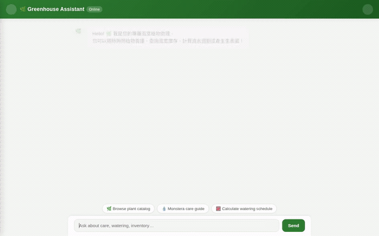

# 🌿 Greenhouse Assistant (`greenhouse-agent`)

> An intelligent, agent-first botanical and greenhouse companion built on Google Cloud Agent Platform, ADK (Agent Development Kit), and Gemini.

<div align="center">



[](https://google.github.io/adk-docs/)
[](https://cloud.google.com/products/agent-platform)
[](https://cloud.google.com/vertex-ai)
[](LICENSE)

</div>

---

## 📖 Overview

**Greenhouse Assistant** is an agentic AI assistant designed for plant enthusiasts and greenhouse managers. It leverages the Google Agent Development Kit (ADK) to combine conversation, structured database retrieval, cloud storage, live environmental climate analysis, code execution sandbox, and on-demand multimodal generation (photographs and short videos).

Instead of returning walls of plain text, the agent formats structured responses into interactive **A2UI** (Agent-to-UI) cards, complete with live data and generated media.

---

## 🛠️ Actually Implemented Capabilities & Cloud Services

The capabilities below are fully wired into the codebase (`greenhouse-agent/app/` and `frontend/`):

### 1. 🧠 Long-Term Memory (Vertex AI Memory Bank)
- **Automatic Session Ingestion**: Extracts facts, user plant preferences, light conditions, and care history across multi-turn sessions using `generate_memories_callback`.
- **Preload Memory**: Injects historical user facts and preferences at session startup via `PreloadMemoryTool`.

### 2. 🗄️ Database & Inventory Management (Google Cloud Firestore)
- **Catalog Inspection (`list_plants`)**: Retrieves real-time greenhouse inventory from the `greenhouse_inventory` Firestore collection.
- **Plant Care Lookup (`get_plant`)**: Fetches detailed watering intervals, sunlight needs, soil requirements, and toxicity information.
- **Inventory Updates (`save_plant`)**: Adds or updates plant records directly in Firestore.
- **Care History Logging (`log_plant_care`)**: Tracks timestamps and notes for watering, fertilizing, and pruning events in the `plant_care_logs` subcollection.

### 3. 🖼️ Botanical Image Generation (Gemini 3.1 Flash Lite Image)
- **Tool (`generate_plant_image`)**: Generates photorealistic botanical images using `gemini-3.1-flash-lite-image` on Vertex AI (global region).
- **Dual Destination**:
  - Saves in-memory image bytes to the ADK `ToolContext` artifact store for display in the developer playground.
  - Uploads directly to a public **Google Cloud Storage** bucket and returns a permanent public HTTPS URL (`https://storage.googleapis.com/...`).

### 4. 🎥 Botanical Video Generation (Gemini Omni)
- **Tool (`generate_plant_video`)**: Generates short 720p botanical timelapse and growth videos using `gemini-omni-flash-preview` on Vertex AI via the Interactions API.
- **Dual Destination**: Registers as an ADK artifact and uploads directly in-memory to Google Cloud Storage.

### 5. 🌡️ Real-Time Environment & Weather (Open-Meteo API)
- **Tool (`get_plant_environment`)**: Geocodes any city worldwide and fetches real-time temperature, humidity, and precipitation to calculate actionable botanical alerts (e.g., tropical cold-stress warnings, dry air alerts).

### 6. 🧮 Schedule Calculation & Code Execution Sandbox
- **Tool (`calculate_next_watering`)**: Computes exact upcoming care dates and remaining days.
- **Sandbox Execution**: Configured with `AgentEngineSandboxCodeExecutor` on Agent Platform to safely run dynamic Python calculations in an isolated sandbox environment.

### 7. 🪟 Agent-First User Interface (A2UI v0.8)
- Emits structured A2UI JSON specifications rendered client-side into rich components (`Card`, `Column`, `Row`, `Text`, `Image`, `Divider`, `Icon`).

### 8. 🌐 Modern Web Frontend (FastAPI + Vanilla JS)
- Custom frontend communicating over the **A2A Protocol**.
- Features include:
  - **Typing Indicator**: Bouncing wave animation with rotating greenhouse status stages.
  - **Sidebar Drawer**: Live greenhouse climate metrics, quick plant lookup shortcuts, and chat clearing.
  - **Image Lightbox**: Fullscreen preview, zoom, and download for generated botanical images.
  - **Forest Night Dark Mode**: High-contrast theme persisted via `localStorage`.
  - **Quick Prompts & Dynamic Suggestions**: Clickable example chips and follow-up care suggestions.

---

## 🏗️ System Architecture

```
┌────────────────────────────────────────────────────────┐
│                   Web Browser UI                       │
│    (FastAPI Proxy / Chat UI / A2UI Renderer / Lightbox)│
└───────────────────────────┬────────────────────────────┘
                            │ A2A Protocol (/chat)
┌───────────────────────────▼────────────────────────────┐
│              greenhouse-agent (ADK App)                │
│             Model: gemini-3.8-flash                    │
└──────┬──────────────┬───────────────┬────────────┬─────┘
       │              │               │            │
┌──────▼──────┐┌──────▼───────┐┌──────▼──────┐┌────▼─────────────┐
│  Firestore  ││ Memory Bank  ││ Cloud Storage││  Gemini Vision   │
│ (Inventory  ││ (Preferences ││(Public Media││   & Omni Video   │
│   & Logs)   ││  & History)  ││   Bucket)   ││ (Global Endpoint)│
└─────────────┘└──────────────┘└─────────────┘└──────────────────┘
```

---

## 🚀 Local Setup & Development

Follow the instructions below to run the agent and frontend locally.

### Prerequisites

- **Python**: 3.12 or 3.13
- **Node.js**: v18+ (optional, for demo recording)
- **Google Cloud SDK (`gcloud`)**: authenticated with appropriate project permissions:
  ```bash
  gcloud auth login
  gcloud auth application-default login
  gcloud config set project YOUR_PROJECT_ID
  ```

### 1. Run the Agent Locally with ADK

Navigate to the agent directory, install dependencies, and start the local development server:

```bash
cd greenhouse-agent

# Install dependencies using uv or pip
uv sync

# Start the ADK web development playground
uv run adk web . --port 8000 --reload_agents
```

### 2. Run the Custom Web Frontend

In a separate terminal, launch the FastAPI frontend proxy:

```bash
cd frontend

# Install frontend dependencies
python3 -m venv .venv
source .venv/bin/activate
pip install -r requirements.txt

# Set local agent target and start proxy server
export AGENT_DIRECTORY="../greenhouse-agent/app"
export PORT="8080"
python main.py
```

The frontend will start and bind locally to port 8080.

---

## 📂 Project Structure

```
.
├── .agents/
│   └── skills/
│       ├── build-agent-frontend/ # Frontend scaffolding & A2UI skill
│       ├── record-demo/          # Playwright-driven demo recorder
│       └── setup-memory-bank/    # Vertex AI Memory Bank setup guide
├── assets/
│   ├── demo.gif                  # Recorded looping demo clip
│   └── build-with-gemini-banner.png
├── frontend/
│   ├── static/
│   │   └── index.html            # Botanical chat interface & A2UI client
│   ├── Dockerfile                # Containerfile for Cloud Run deployment
│   ├── main.py                   # FastAPI A2A client proxy
│   └── requirements.txt
├── greenhouse-agent/
│   ├── app/
│   │   ├── a2ui_utils.py         # A2UI callback filter
│   │   ├── agent.py              # Root ADK agent configuration & tools
│   │   └── tools.py              # Firestore, Storage, Gemini Image & Video tools
│   ├── tests/                    # Integration and unit tests
│   ├── pyproject.toml            # Dependencies and ADK project configuration
│   └── agents-cli-manifest.yaml  # Agent manifest
├── greenhouse_agent_demo.webm    # Original demo video recording
└── project_brief.md              # Original project brief
```

---

## 📄 License

This project is licensed under the Apache License 2.0 - see the [LICENSE](LICENSE) file for details.
